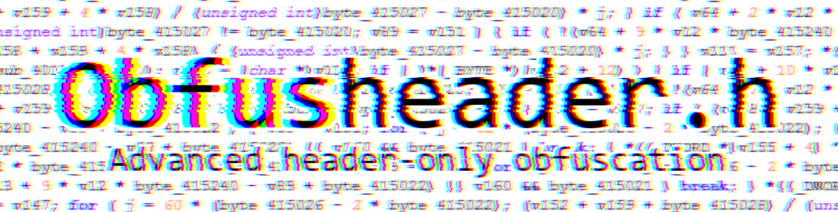
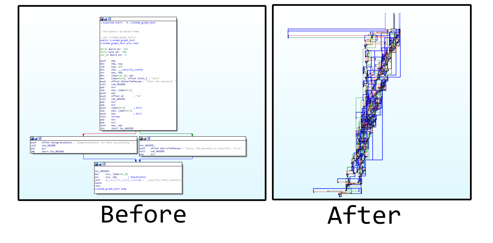
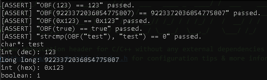
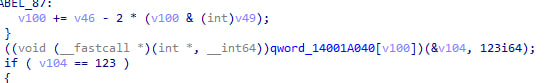
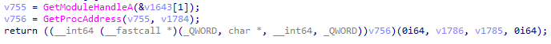
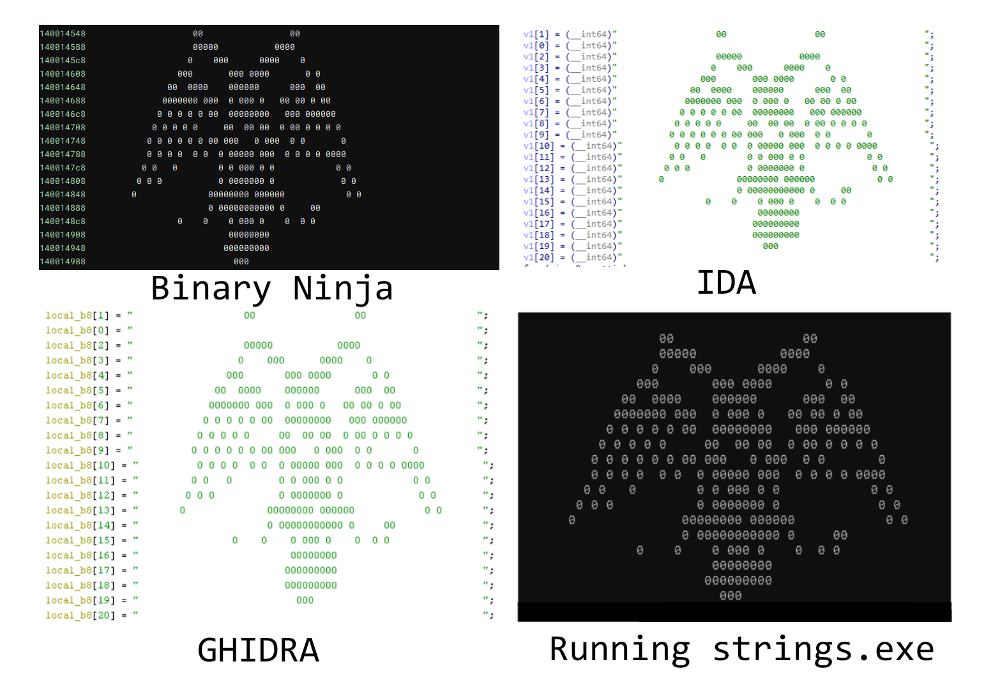
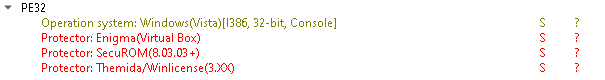
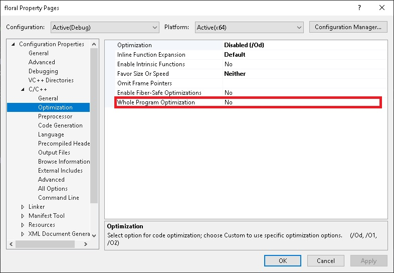

# Obfusheader.h
<div align=center style="background-color: transparent;">
    </img>
</div>

Obfusheader.h is a header-only library for C++14 and above, offering compile-time obfuscation through metaprogramming: string & decimal encryption, control-flow mutation, call hiding and import hiding. It is self-contained, compatible with Windows and Linux, and supports g++, clang and Visual C++ on x86, x64, ARM64 and ARM32. Everything is decided while compiling, so the binary carries ciphertext and no plaintext, and there is nothing to run or configure at runtime.

The header is organised into 15 numbered sections, one per protection, so each part can be read, ported or switched off on its own.

## 🛠️ Current features

<div align=center style="background-color: transparent;">
    </img>
    <text>Sample crackme with & without obfusheader.h</text>
</div>

### Obfuscation features
- Fully compile-time constant encryption (strings, chars, integers and **bools**) with two modes - `NORMAL` & `THREADLOCAL` - and a per-site key generated at compile time
- Hidden references to the encrypted data: each payload sits in a table of same-sized decoy rows, reached through an obfuscated index, exactly like the hidden call tables
- Anti-tamper check: the compiler records a checksum of the original payload and the decryptor re-verifies it, so a patched binary hands out re-encrypted garbage instead of plaintext
- Call hiding (compile-time function pointer array shuffling with decoy stubs)
- Imports hiding without `GetProcAddress` / `dlsym`: PEB walking on Windows, ELF program-header and symbol-hash-table parsing on Linux, with the API names resolved as compile-time hashes
- `if`/`else`/`for`/`while`/`switch`/`return` control-flow mutation with opaque predicates, plus a mode that keeps all of it legal inside `constexpr` code
- Polymorphic inline asm engine: 12 executed and 6 unreachable trap blocks per architecture, combined randomly per expansion site
- Purely compile-time randomness from macro constants (\_\_TIME\_\_, \_\_LINE\_\_, \_\_COUNTER\_\_) mixed through an avalanche hash, so no seed or timestamp survives in the binary
- Watermarking - messages left in the binary that survive any optimization and show up in decompilers
- Fake signatures to trick DIE (Detect-It-Easy) and other detectors into reporting VMProtect, Themida, Denuvo & friends

### Additional modules
- Fully inline implementations of common C string routines (`strcpy`, `strlen`, `strncat`, `strcmp`, `strncmp`, `strstr`, `strtoul`), so nothing hookable is imported

## 📑 Usage

Add the include directory to your project and include the header:

```c++
#include "obfusheader.h"
```

⚠️ **Include it last.** Section 15 redefines the keywords `if`, `else`, `for`, `while`, `switch` and `return`, and a macro affects every line that comes after it - including any standard library or third-party header you include afterwards. Put obfusheader.h below your other includes, or set `CFLOW_BRANCHING 0`.

`if constexpr (...)` is never mutated: the macro is function-like, so it only fires when `(` directly follows `if`.

### Settings

Every option is guarded with `#ifndef`, so you never have to edit the file - set it before the include, or per translation unit on the command line:

```c++
#define CFLOW_BRANCHING 0        // this file is full of constexpr code
#include "obfusheader.h"
```

```
g++ -O2 -DCFLOW_ASM_JUNK=0 -DVAULT_SLOTS=6 main.cpp
```

The defaults, in the order they appear in section 1:

| Option | Default | Meaning |
|---|---|---|
| `CONST_ENCRYPTION` | `1` | Encrypt literals passed to `OBF()` / `MAKEOBF()` |
| `CONST_ENCRYPT_MODE` | `OBF_MODE_NORMAL` | `OBF_MODE_NORMAL` or `OBF_MODE_THREADLOCAL` (`NORMAL` / `THREADLOCAL` still accepted) |
| `VAULT_SLOTS` | `4` | Decoy rows stored next to each payload (1-8) |
| `VAULT_CHECK` | `1` | Verify the decrypted payload against a compile-time checksum |
| `CFLOW_BRANCHING` | `1` | Master switch for the keyword mutation |
| `CFLOW_CONST_DECRYPTION` | `1` | Fake branches inside the string/decimal decryptor |
| `CFLOW_ASM_JUNK` | `1` | `0` removes all inline asm from control flow, making it legal inside `constexpr` |
| `CFLOW_IF` / `CFLOW_ELSE` / `CFLOW_FOR` / `CFLOW_WHILE` / `CFLOW_SWITCH` / `CFLOW_RETURN` | = `CFLOW_BRANCHING` | Leave individual keywords alone |
| `INDIRECT_BRANCHING` | `1` | Opaque conditional jumps inside the runtime gate |
| `JUNK_ASM` | `1` | Emit polymorphic asm blocks (`ASM_JUNK`, `STACKBRK`) |
| `JUNK_TRAP` | `1` | Emit unreachable `int3` / `ud2` / `brk` / `bkpt` bait |
| `CALL_SLOTS` | `10` | Entries in a hidden call table (2-10) |
| `IMPORT_RESOLVER` | `OBF_RESOLVER_AUTO` | `OBF_RESOLVER_AUTO` / `_MANUAL` / `_API` |
| `IMPORT_CACHE` | `1` | Cache resolved imports XOR-masked in `.data` |
| `FAKE_SIGNATURES` | `0` | Protector bait sections (section 13) |
| `INLINE_STD` | `1` | The inline string routines (section 14) |
| `KERNEL_MODE` | `0` | Never pull in `<windows.h>` / `<dlfcn.h>` |
| `WATERMARKING` | `1` | Enable the `WATERMARK()` machinery |

Bad combinations are caught at compile time with a pointed `#error` instead of failing much later inside a template.

### Compile-time constant encryption

You can encrypt strings, chars and any integer type. The macro is universal - it deduces the element type and length from the argument.

```c++
printf("char*: %s\n"
       "int (dec): %d\n"
       "long long: %lld\n"
       "int (hex): 0x%x\n"
       "boolean: %d\n",
       OBF("test"), OBF(123),
       OBF(9223372036854775807LL),
       OBF(0x123), OBF(true));
```

The logic of the program is not affected: the original values are restored at runtime and **never present in the binary**. Only compile-time constants can be encrypted - a literal, or a `constexpr` object with static storage.

Bools are encrypted correctly on their own. The previous release needed `#define true 1` / `#define false 0` for this, because the payload was stored in a `bool` and lost every key bit but the last while the decryptor tested for non-zero; `OBF(true)` silently came back as `false`. The payload is now stored in an unsigned integer of the same width as its type, so no keywords are redefined anywhere in the header.

Three layers make each string hard to find:

- The bytes are cipher text, produced by a hash of `(key, index)` rather than `key + index`, so a long string does not walk into the next key byte.
- The xor is picked per site out of five algebraic identities, so two identical literals do not decrypt through the same code.
- The payload lives in a table of `VAULT_SLOTS` same-sized rows where only one is real, and the row is selected through a masked index recovered by a call that cannot be inlined. Neither the instruction nor the static layout points at the string.

⚠️ There are no dynamic allocations. Decryption happens in the caller's own frame, so the value is only valid while the object holding it is alive:

```c++
// Not safe: the row belongs to a temporary that dies with the statement
const char* str = OBF("test");
printf("1: %s\n", str);

// Safe: the pointer is used inside the same full-expression
printf("2: %s\n", OBF("test"));

// Safe: MAKEOBF keeps the encrypted object alive, and it decrypts itself on first use
auto obf = MAKEOBF("test");
printf("3: %s\n", (char*)obf);
printf("4: %s\n", (char*)obf);   // still correct, it will not decrypt twice
```

With `CONST_ENCRYPT_MODE` set to `THREADLOCAL` each thread decrypts once and reuses that copy.

`VAULT_CHECK` additionally stores a checksum the compiler took from the plaintext. If the cipher text or the decryptor is patched, the check no longer matches and the payload is quietly re-encrypted instead of being handed out. Set it to `0` if you want the extra pass gone.

<div align=center>
    <br/>
    <text>The logic isn't affected - the data is decrypted in runtime</text>
</div>

<br/>

### Control flow mutation

With `CFLOW_BRANCHING` on, the keywords are rewritten through opaque predicates built on a volatile constant pool, so the loads cannot be folded and the fake branches survive into the release build:

```c++
if (inline_strcmp(password, correct) == 0) {   // mutated, still one branch
    ...
}
```

Each mutation preserves behaviour: the guard loop runs exactly once, `return` keeps returning on every path, and `else` rebinds to a branch that can never be taken. Conditions containing commas (`if (a, b)`) keep working.

The mutation is per keyword, so a file that cannot take one can opt out of just that keyword:

```c++
#define CFLOW_SWITCH 0    // a big switch-based state machine
#include "obfusheader.h"
```

### Constexpr / compile-time code

Inline asm, volatile reads and non-`constexpr` calls are not allowed inside a constant expression, so the mutated keywords used to break every `constexpr` function and `static_assert` in a project. `CFLOW_ASM_JUNK 0` fixes that: the same opaque predicates are rebuilt on a `constexpr` gate that reads nothing volatile and contains no asm.

```c++
#define CFLOW_ASM_JUNK 0
#include "obfusheader.h"

constexpr int sum(int n) {
    int total = 0;
    for (int i = 1; i <= n; ++i) {   // mutated, still constant-evaluable
        if (i % 2 == 0) total += i;
        else            total += 1;
    }
    return total;
}
static_assert(sum(6) == 15, "");
```

The gate stays `__declspec(noinline)` / `__attribute__((noinline))`, so it is *not* folded back into nothing in ordinary code - measured 1042 un-inlined gate calls in an optimized test binary. Two costs are deliberate and worth knowing: `return` is left alone before C++20 (a `case` label is not allowed in a constant expression, and any loop wrapper makes clang claim a missing return value), and the never-taken decoy blocks can be folded away since nothing forces them to stay.

### Call hiding

Internal calls are hidden by generating a randomly shuffled function pointer table at compile time and obfuscating the origin index; the unused slots hold decoy stubs and impossible addresses.

```c++
CALL(&printf, "Very secure call\n");
HIDE_PTR(&some_function)(args);
```

<div align=center>
    <br/>
    <text>Call hiding demo</text>
</div>
<br/>

### Import hiding

External APIs are resolved by reading the loader's own data structures instead of asking for them, so the call leaves nothing in the import table:

- **Windows** - `TEB` -> `PEB` -> `Ldr->InMemoryOrderModuleList`, then the PE export directory of the matching module.
- **Linux** - the image's `DT_DEBUG` -> the linker's `r_debug` -> the link map chain, then each object's GNU or SYSV symbol hash table.

The names never appear as strings: they are matched as compile-time hashes mixed with a per-build salt, so neither `"LoadLibraryA"` nor `"kernel32.dll"` is in the binary, and the hashes cannot be looked up in a pre-computed table. The resolved pointer is cached XOR-masked, so even the `.data` slot does not look like a function pointer.

```c++
typedef HMODULE(WINAPI* load_lib_t)(LPCSTR);
typedef int (WINAPI* msg_box_t)(HWND, LPCSTR, LPCSTR, UINT);

CALL_EXPORT("kernel32.dll", "LoadLibraryA", load_lib_t, "user32.dll");
CALL_EXPORT("user32.dll",  "MessageBoxA",  msg_box_t, NULL, "Real", "Msgbox", MB_OK);
```

The signature is the same on both systems now - `(module, symbol, prototype, args...)`. On Linux the module is matched against the object's file name, so pass `"libc.so.6"`, `"libm.so.6"`, and so on.

⚠️ Two things about that third argument. It must describe the API as it really is: on 32-bit Windows the Win32 functions are `WINAPI` (`__stdcall`), and calling one through a plain cdecl pointer leaves the stack wrong - on x64 there is a single convention so this cannot happen. And name the type through a `typedef` (or `using`): `CALL_EXPORT(..., HMODULE(WINAPI*)(LPCSTR), ...)` looks equivalent, but the macro expands its prototype into a cast and MSVC reads `HMODULE(...)` there as a functional cast instead of a type (error C2143), while clang accepts it.

`IMPORT_RESOLVER` selects the backend: `OBF_RESOLVER_AUTO` (default) tries the manual walk and falls back to `GetProcAddress` / `dlsym`, `OBF_RESOLVER_MANUAL` never references those APIs at all, `OBF_RESOLVER_API` keeps the old behaviour. If nothing can resolve the name you get a null pointer back rather than a random address.

The Linux walk follows the glibc link map layout (bionic matches it). Other libc layouts are rejected by the sanity checks and fall back to `dlsym`, so they resolve correctly but are not hidden.

<br/>
    <div align=center>
        <br/>
        <text>Import hiding demo</text>
    </div>
<br/>

### Assembly junk

Two macros can be dropped into any function. Each expansion draws four independent random numbers, so the emitted blocks and their order differ per site - about 12^4 shapes:

- `ASM_JUNK` - executed instructions. Every one is a no-op or works on a scratch register the compiler owns, so program state never changes.
- `STACKBRK` - the same plus trap encodings (`int3`, `ud2`, `brk`, `bkpt`) parked inside a branch the volatile predicate never takes, giving a disassembler breakpoints that are never reached.

The blocks are defined per target: GNU asm for x86, x64, ARM64 and ARM32; byte-emitting `__asm` for MSVC x86; `__nop()` / `_mm_pause()` / `__debugbreak()` for MSVC x64, which has no inline asm. On any unsupported combination the macros expand to nothing.

`INDIRECT_BRANCH` is the separate trick that breaks IDA's decompiler: an opaque conditional jump over a byte that disassembles as the start of an instruction.

### Binary watermarking

Leave messages and ASCII art in your binary that do not affect execution but appear in IDA/GHIDRA. Use the **WATERMARK** macro; inspired by <a href="https://github.com/xoreaxeaxeax/REpsych">REpsych</a> and some java obfuscators which also do that.

```c++
WATERMARK("                                                           ",
          "                   00                 00                   ",
          "                   00000           0000                    ",
          "                  0    000      0000    0                  ",
          "                000       000 0000       0 0               ",
          "              00  0000    000000      000  00              ",
          "             0000000 000  0 000 0   00 00 0 00             ",
          "            0 0 0 0 0 00  00000000   000 000000            ",
          "           0 0 0 0 0     00  00 00  0 00 0 0 0 0           ",
          "          0 0 0 0 0 0 00 000   0 000  0 0       0          ",
          "          0 0 0 0  0 0  0 00000 000  0 0 0 0 0000          ",
          "         0 0   0        0 0 000 0 0            0 0         ",
          "        0 0 0           0 0000000 0             0 0        ",
          "       0              00000000 000000            0 0       ",
          "                      0 00000000000 0     00               ",
          "                0    0    0 000 0    0  0 0                ",
          "                          00000000                         ",
          "                         000000000                         ",
          "                         000000000                         ",
          "                           000                             ",
          "                                                           ");
```

The strings are pushed through a volatile function pointer that is initialised to a real function, so they survive optimization and land in the decompiler's cross-reference window as a plausible drawing routine.

<div align=center>
    <br/>
    <text>Watermarking in different RE tools</text>
</div>
<br/>

### Fake signatures

A windows-only feature that adds sections Detect-It-Easy, PeExeInfo and Nauz File Detector attribute to commercial protectors, making a reverse-engineer doubt the binary is worth the time.

```c++
#define FAKE_SIGNATURES 1
```

<div align=center>
    <br/>
    <text>Detect-It-Easy output</text>
</div>
<br/>

⚠️ If you're using Visual C++ be sure to disable whole program optimization in the project properties. Otherwise the compiler won't create additional sections in the binary.
<div align=center>
    <br/>
</div>
<br/>

### Additional features & modules

**RND(min, max)** generates a compile-time random number. Every expansion draws its own value from \_\_COUNTER\_\_, \_\_LINE\_\_ and \_\_TIME\_\_ after an avalanche mix.

```c++
printf("Some random value: %d\n", RND(0, 10));
```

**INLINE** and **NOINLINE** force or forbid inlining on any compiler. **SECTION(name)** places a variable in a custom section. **CAST(T, v)**, **RCAST(T, v)** and **CCAST(T, v)** are the portable spellings of the named casts, and work in C too.

**OBF_HASH(name)**, **OBF_HASH_LOWER(name)** and **OBF_ELF_HASH(name)** compute a name's hash at compile time; `OBF_HASH` is salted per build, `OBF_ELF_HASH` is the plain ELF hash the loader's own tables use.

**BLOCK_TRUE(...)** / **BLOCK_FALSE(...)** wrap a statement in an opaque always-taken / never-taken branch. **SEGFAULT** is a deliberate hard fault for a path that must never be reached.

Also obfusheader reimplements the most common C string methods fully inlined: **strcpy, strlen, strncat, strcmp, strncmp, strstr, strtoul**. Use them to avoid hookable imports.

```c++
if (inline_strcmp(password, correctPassword) == OBF(0)) {
    printf(OBF("Congratulations! You have successfully cracked the program. \n"));
} else {
    printf(OBF("Sorry, the password is incorrect. Try again!\n"));
}
```

## 🧪 Testing

Three automated test programs live in `tests/`:

```
g++ -std=c++14 -O2 -I../include selftest.cpp    -o selftest.exe && selftest.exe
cl    /std:c++14 /O2 /I../include selftest.cpp /Fe:selftest.exe && selftest.exe
```

- **`selftest.cpp`** - asserts on behaviour (716 checks: encryption of every supported type, the vault, hidden calls, import resolution against `GetProcAddress`, all mutated keywords with counted side effects) and exits with the number of failures. It compiles warning-free under `-Wall -Wextra` and `/W3`.
- **`leak_probe.cpp`** - literals used *only* inside `OBF()`, for scanning the produced binary for plaintext. The self-test cannot serve this purpose because a failed assertion prints the condition it tested.
- **`c_fallback.c`** - the C path, where `OBF()` is identity but the control flow mutation and string routines still apply.
- **`cpp_tests.cpp`** - the original interactive crackme demo.

The optimization and flag matrix (`-O0/-O2/-O3/-Os`, C++14/17/20, `-fPIC`, `-fPIE`, `-fstack-protector-all`) plus every individual configuration switch were swept on clang. On Visual C++ both targets were swept at `/Od` and `/O2` with a subset of the configurations (`CFLOW_ASM_JUNK=0`, `CFLOW_BRANCHING=0`, `THREADLOCAL`, manual-only resolver, junk off); `x86` matters because it is the only MSVC build where the inline asm is really assembled. The Linux and ARM code paths are compiled and assembled cross-target (`x86_64`, `i686`, `aarch64`, `armv7` Linux) but have never been executed, so treat them as unverified at runtime.

## ⚠️ Known limitations

- Floating point literals cannot be encrypted. Reaching a `float`'s bit pattern at compile time needs `std::bit_cast`, i.e. C++20; the header rejects the attempt with a `static_assert` naming that reason rather than quietly producing a wrong value.
- The runtime decryptors are not `constexpr`, so `OBF()` works at runtime only, and only on literals.
- Whole-program optimisation and link-time codegen (`/GL /link /LTCG`) were exercised and hold up: the probe still builds, decrypts correctly and leaks no plaintext. The runtime decryptors themselves are never `constexpr`, so nothing in the decryption path is ever evaluated at compile time.
- Section 15's keyword mutation is global and textual: it applies to anything after the include. Turn it off per file, or per keyword, when a third-party header cannot take it.

## ⭐ Credits

Special thanks to these people: <a href="https://github.com/dosx-dev">DosX-dev</a>, <a href="https://github.com/ARandomPerson7">RandomPerson7</a> for suggestions & great ideas! Your help is greatly appreciated
